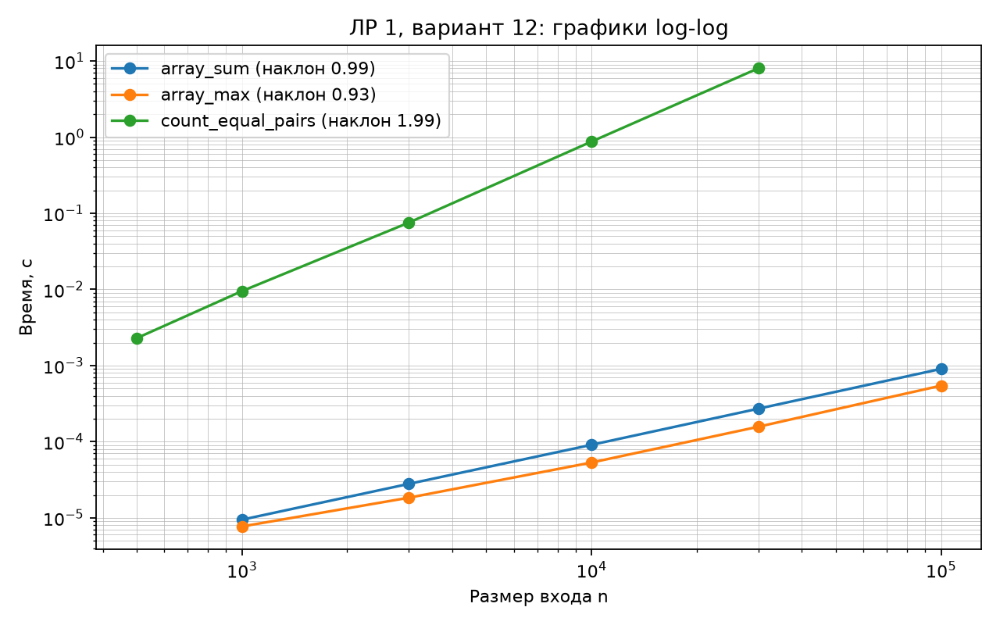
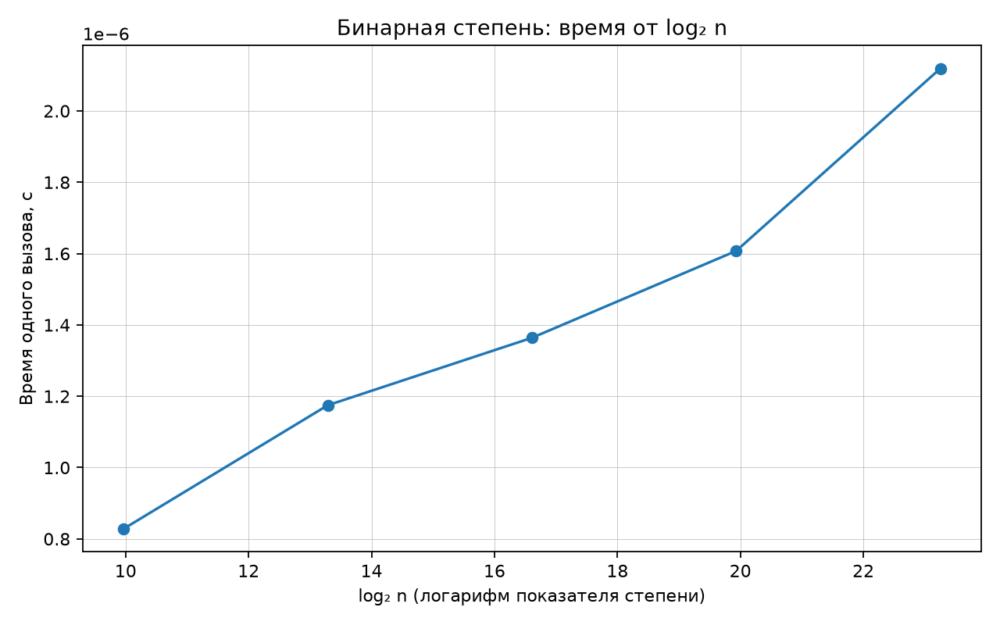

# Лабораторная работа № 1. Анализ временной сложности элементарных алгоритмов

**Дисциплина:** Структуры и алгоритмы обработки данных (СИАОД)  
**Вариант:** 12  
**Seed:** 42  
**Студент:** Тесля Владислав Германович, БВТ2502

## Цель

Аналитически оценить сложность четырёх алгоритмов, проверить корректность, измерить время работы и сопоставить теорию с практикой.

## Теоретический анализ (худший случай)

| Алгоритм | Временная сложность | Обоснование |
|---|---|---|
| Сумма элементов | Θ(n), O(n) | Один проход по n элементам. |
| Поиск максимума | Θ(n), O(n) | Сравнение с текущим максимумом для каждого элемента. |
| Подсчёт равных пар | Θ(n²), O(n²) | Проверяются n(n−1)/2 пар элементов двумя циклами. |
| Бинарная степень | Θ(log(n+1)), O(log(n+1)) | После каждого шага показатель делится на 2; число шагов равно числу его двоичных разрядов. |

В указанных оценках операции над целыми числами считаются O(1) по модели RAM. При возведении в степень фиксированный модуль ограничивает длину чисел.

Дополнительная память у всех четырёх реализаций — O(1), если не считать память, занятую входным массивом и длинной арифметикой без модуля.

## Среда и методика замеров

- Система: `Darwin 24.3.0`; архитектура `arm64`.
- Python: `3.13.5`.
- CPU: Apple M4 Pro.
- Данные: вариант 12, seed 42; генератор массива соответствует `scripts/generate_data.py --variant 12 --only arrays`.
- Таймер: `time.perf_counter()`; один прогрев и 5 измерений, результат — медиана.
- Для O(n²) взяты размеры 500, 1000, 3000, 10000, 30000 (как в заготовке).
- Для `binary_pow` измерялось 20000 вызовов, затем время делилось на их число; модуль 1000000007.

## Фактические замеры

### `array_sum`

| n | Медианное время, с |
|---:|---:|
| 1000 | 0.000009458 |
| 3000 | 0.000027917 |
| 10000 | 0.000090959 |
| 30000 | 0.000271291 |
| 100000 | 0.000904208 |

### `array_max`

| n | Медианное время, с |
|---:|---:|
| 1000 | 0.000007708 |
| 3000 | 0.000018375 |
| 10000 | 0.000053250 |
| 30000 | 0.000157167 |
| 100000 | 0.000544750 |

### `count_equal_pairs`

| n | Медианное время, с |
|---:|---:|
| 500 | 0.002289084 |
| 1000 | 0.009495750 |
| 3000 | 0.075262666 |
| 10000 | 0.873292500 |
| 30000 | 8.008335334 |

### `binary_pow`

| n | Медианное время, с |
|---:|---:|
| 1000 | 0.000000828 |
| 10000 | 0.000001175 |
| 100000 | 0.000001364 |
| 1000000 | 0.000001607 |
| 10000000 | 0.000002119 |

## Графики

## Сравнение экспериментальных наклонов с теорией

| Алгоритм | Ожидаемый наклон | Измеренный наклон |
|---|---:|---:|
| Сумма | 1 | 0.990 |
| Максимум | 1 | 0.926 |
| Равные пары | 2 | 1.987 |

Для степенных функций t ≈ C·n^k в координатах log(t) и log(n) получается log(t) ≈ log(C) + k·log(n), поэтому наклон линии близок к k.
Фактические наклоны могут отличаться от 1 и 2 из-за накладных расходов интерпретатора Python, кэша процессора, фоновых процессов, частоты CPU и небольшой выборки точек. Особенности значения коэффициента зависят от измерений на данном компьютере.

Для `binary_pow` построена зависимость времени от log₂(n) в обычных линейных осях: число итераций цикла пропорционально количеству бит показателя. На log-log графике log₂(n) сама попадает под логарифм, поэтому график почти горизонтален и его наклон не показывает степень n.

Вычисления по модулю необходимы: в Python целые числа неограниченной длины. Без модуля размер x^n растёт, и измеряется также стоимость арифметики с огромными числами, а не только число итераций цикла.

## Верификация

1. **Инварианты:** `array_sum` накапливает сумму уже просмотренных чисел; `array_max` хранит максимум просмотренного префикса; `count_equal_pairs` считает только пары i < j и каждую один раз; `binary_pow` сохраняет равенство `result * x**n` исходной степени (по модулю, если он задан).
2. **Граничные случаи:** пустой массив, один элемент, отрицательные числа, все элементы одинаковы, попарно различные, показатель 0, вычисления по модулю.
3. **Сверка с эталоном:** 200 наборов массивов с `sum` и `max`, подсчёт пар по частотам; 200 случаев для `pow` (модульного и обычного). Все встроенные `assert` завершились успешно: `self_check: OK`.
4. **Сложность:** выводы аналитически обоснованы и проверены графиками.

## Вывод

Тесты не обнаружили ошибок; результаты демонстрируют различие между линейным, квадратичным и логарифмическим ростом времени. Применение реализованных алгоритмов обосновано в пределах поставленной задачи. **Вердикт верификации:** тесты и проверки пройдены; наблюдаемые зависимости соответствуют теоретическим оценкам.
