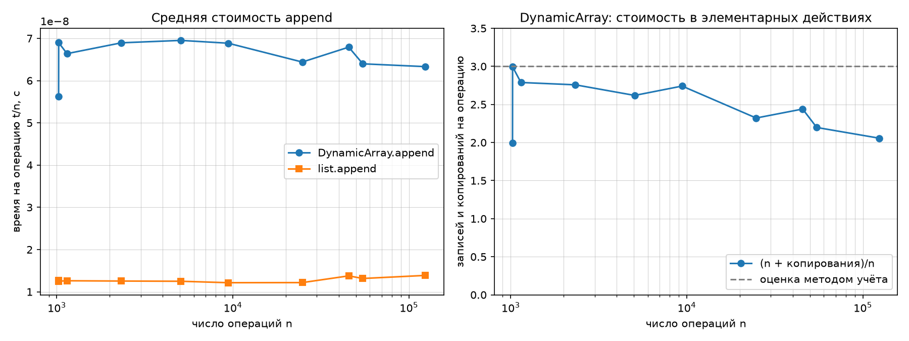
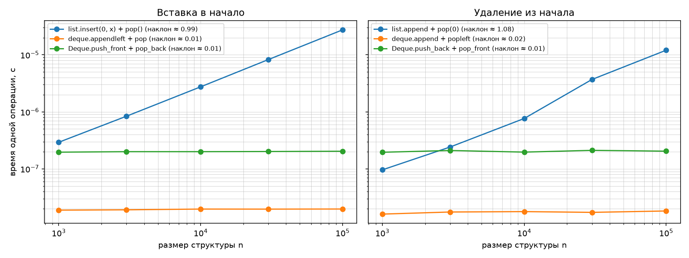

# Лабораторная работа № 2 — рекурсивные функции и линейные структуры данных

**Дисциплина:** Структуры и алгоритмы обработки данных (СИАОД)  
**Студент:** Тесля Владислав Германович  
**Группа:** БВТ2502  
**Вариант:** 12; **seed:** 42  
**Среда выполнения:** macOS (macOS-15.3.1-arm64-arm-64bit-Mach-O), Python 3.13.5, чип Apple M4 Pro (данные компьютера студента), запуск 27.10.2026 19:03 MSK  
**Основа реализации:** [решение К. Долговой](https://github.com/KatyaDolgova/SiAOD_labs/blob/main/lab02/lab02-recursion-structures-starter.py), использовано с разрешения автора.  
**Происхождение замеров:** выполнены при запуске приложенного исходного кода с данными варианта 12 на указанном компьютере.

## Цель

Освоить рекурсию, реализацию динамического массива, стека и двусторонней очереди, исследовать временную и амортизированную сложность операций и подтвердить её экспериментально.

## Реализованные алгоритмы и оценки

| Функция / структура | Описание | Оценка времени |
|---|---|---|
| `factorial` | Рекурсивный факториал с базовым случаем | Θ(n) |
| `fib_naive` | Рекурсия Фибоначчи без кеширования | Θ(φⁿ), экспоненциально |
| `fib_memo` | Рекурсия Фибоначчи с мемоизацией | Θ(n) |
| `hanoi` | Ханойские башни: рекурсивная запись ходов | Θ(2ⁿ) |
| `DynamicArray.append` | Добавление с расширением ёмкости вдвое | O(1) амортизированно, O(n) при расширении |
| `DynamicArray.get/set/pop` | Доступ, изменение, удаление с конца | O(1) |
| `Stack.push/pop/peek` | Стек LIFO на собственном динамическом массиве | push амортизированно O(1); pop, peek O(1) |
| `Deque.push_front/pop_front/push_back/pop_back` | Дек на двусвязном списке | O(1) |

## Рекурсия и число вызовов

Факториал использует переход `n! = n × (n−1)!`, а базовый случай `0! = 1` завершает рекурсию. Для Фибоначчи `F(0)=0`, `F(1)=1`, `F(n)=F(n−1)+F(n−2)`: наивный алгоритм много раз решает одинаковые задачи; мемоизация хранит вычисленные значения. Для Ханойских башен число ходов задаётся `T(n)=2T(n−1)+1`, следовательно `T(n)=2ⁿ−1`.

Таблица теоретического числа вызовов для реализации со счётчиком (значения подтверждаются выводом программы):

| n | F(n) | Наивная рекурсия: вызовов | Мемоизация: вызовов |
|---:|---:|---:|---:|
| 5 | 5 | 15 | 9 |
| 10 | 55 | 177 | 19 |
| 15 | 610 | 1 973 | 29 |
| 20 | 6 765 | 21 891 | 39 |
| 25 | 75 025 | 242 785 | 49 |
| 30 | 832 040 | 2 692 537 | 59 |

## Динамический массив: амортизированный анализ

В динамическом массиве хранятся `size` и `capacity`, инвариант `0 ≤ size ≤ capacity`. Если буфер заполнен, выделяется новый буфер с удвоенной ёмкостью и элементы копируются; `copies` учитывает число переносов.

В **методе учёта** каждой операции `append` назначается условная стоимость 3 единицы: единица на запись и две единицы на накопление кредита. Между двумя увеличениями буфера ёмкости `C` выполняется не менее `C/2` добавлений. Накопленные `C` кредитных единиц оплачивают копирование `C` элементов при следующем увеличении буфера. Следовательно, серия из `n` добавлений обходится в O(n), хотя отдельное расширение стоит O(n); на одну операцию приходится **амортизированно O(1)**.

Другой вывод: при начальной ёмкости 4 суммарное число копирований из геометрической последовательности 4+8+16+... меньше 2n, поэтому `(n + copies)/n < 3`.

## Сравнение структур

`list.insert(0, x)` и `list.pop(0)` имеют сложность O(n): требуется сдвигать элементы. Стандартная `collections.deque` и собственный `Deque` на двусвязном списке добавляют и удаляют элементы у концов за O(1). Одинаковая асимптотика не означает равное время: встроенная библиотека Python обычно выигрывает по константе из-за оптимизированной реализации, а собственный список имеет накладные расходы на объекты и указатели.

## Графики по результатам запуска

### Средняя стоимость append и число копирований



### Добавление и удаление у начала структур



На первом графике средняя стоимость `append` остаётся ограниченной, несмотря на отдельные скачки при расширении буфера. На втором рост времени операций у начала `list` соответствует O(n), а линии `deque` и собственного дека близки к O(1). Погрешности возникают из-за накладных расходов интерпретатора, кэша и фоновых задач.

## Проверка корректности

**Тесты завершились успешно: `self_check: OK`.**

Проверяются граничные случаи рекурсии, корректность ходов Ханойских башен, переход через границу расширения массива, переполнение/опустошение стека и дека, инварианты ссылок двусвязного списка, операции заданного варианта в сравнении со стандартными структурами.

## Полный вывод эксперимента

Включает количество вызовов, времена, число копирований и сравнение операций варианта. Результаты в этом разделе получены именно при запуске программы, а не переписаны из чужого отчёта.

```text
Данные варианта 12 (seed=42) из data/generated
self_check:
  рекурсия: OK
  DynamicArray: OK
  Stack: OK
  Deque: OK
  операции варианта: OK
  собственные инварианты: OK
self_check: OK

Число вызовов: наивная рекурсия против мемоизации
  n= 5  F(n)=     5  fib_naive:      15 вызовов  fib_memo:  9 вызовов
  n=10  F(n)=    55  fib_naive:     177 вызовов  fib_memo: 19 вызовов
  n=15  F(n)=   610  fib_naive:    1973 вызовов  fib_memo: 29 вызовов
  n=20  F(n)=  6765  fib_naive:   21891 вызовов  fib_memo: 39 вызовов
  n=25  F(n)= 75025  fib_naive:  242785 вызовов  fib_memo: 49 вызовов
  n=30  F(n)=832040  fib_naive: 2692537 вызовов  fib_memo: 59 вызовов

Серии append на размерах варианта:
  n=   1024  t/n: DynamicArray 5.63e-08 c, list 1.27e-08 c  копирований    1020  (n + копирования)/n = 1.996
  n=   1025  t/n: DynamicArray 6.90e-08 c, list 1.25e-08 c  копирований    2044  (n + копирования)/n = 2.994
  n=   1143  t/n: DynamicArray 6.64e-08 c, list 1.26e-08 c  копирований    2044  (n + копирования)/n = 2.788
  n=   2328  t/n: DynamicArray 6.89e-08 c, list 1.25e-08 c  копирований    4092  (n + копирования)/n = 2.758
  n=   5059  t/n: DynamicArray 6.95e-08 c, list 1.25e-08 c  копирований    8188  (n + копирования)/n = 2.619
  n=   9407  t/n: DynamicArray 6.88e-08 c, list 1.22e-08 c  копирований   16380  (n + копирования)/n = 2.741
  n=  24788  t/n: DynamicArray 6.44e-08 c, list 1.22e-08 c  копирований   32764  (n + копирования)/n = 2.322
  n=  45519  t/n: DynamicArray 6.79e-08 c, list 1.38e-08 c  копирований   65532  (n + копирования)/n = 2.440
  n=  54722  t/n: DynamicArray 6.40e-08 c, list 1.32e-08 c  копирований   65532  (n + копирования)/n = 2.198
  n= 124040  t/n: DynamicArray 6.33e-08 c, list 1.39e-08 c  копирований  131068  (n + копирования)/n = 2.057

Вставка в начало: время одной операции при размере n = 1000, 3000, 10000, 30000, 100000
  list.insert(0, x) + pop()    2.93e-07  8.38e-07  2.75e-06  8.26e-06  2.74e-05   наклон 0.99
  deque.appendleft + pop       1.89e-08  1.91e-08  1.97e-08  1.97e-08  1.98e-08   наклон 0.01
  Deque.push_front + pop_back  1.96e-07  2.00e-07  2.00e-07  2.01e-07  2.04e-07   наклон 0.01

Удаление из начала: время одной операции при размере n = 1000, 3000, 10000, 30000, 100000
  list.append + pop(0)         9.61e-08  2.41e-07  7.66e-07  3.70e-06  1.21e-05   наклон 1.08
  deque.append + popleft       1.61e-08  1.75e-08  1.78e-08  1.73e-08  1.83e-08   наклон 0.02
  Deque.push_back + pop_front  1.95e-07  2.10e-07  1.97e-07  2.11e-07  2.04e-07   наклон 0.01

Операции варианта целиком: время на операцию
  ops_stack.txt: Stack 9.52e-08 c, list 2.32e-08 c - в 4.1 раза медленнее
  ops_deque.txt: Deque 1.30e-07 c, collections.deque 2.66e-08 c - в 4.9 раза медленнее

Графики сохранены:
  results/lab02_append.png
  results/lab02_front.png
```

## Вывод

Мемоизация сокращает число вычислений Фибоначчи с экспоненциального до линейного. Увеличение буфера в два раза обеспечивает амортизированную стоимость добавления O(1). Для операций у начала `list` требуется сдвиг O(n) элементов, а двусторонняя очередь позволяет выполнить их за O(1). Реальные замеры в журнале и графиках дополняют теоретические оценки.

## Источники

- [Задание КИМ-02 преподавателя](https://github.com/mel0d1an/data-structures-and-algorithms/blob/main/M1-intro-and-basic-structures/kim-02-recursion-linear-structures.md)
- [Официальный генератор преподавателя](https://github.com/mel0d1an/data-structures-and-algorithms/blob/main/scripts/generate_data.py)
